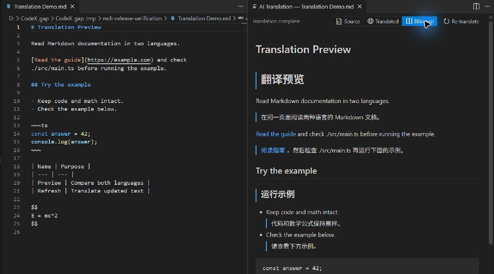

# Markdown AI Translator

[简体中文](README.zh-CN.md) · [Release guide](docs/PUBLISHING.md) · [Changelog](CHANGELOG.md)

Read Markdown documentation in VS Code with a translated preview beside the editor. Switch between **Source**, **Translated** and **Bilingual** without modifying the Markdown file.

The screenshots and [animated demo](docs/images/preview-demo.gif) use a local test server with fixed example translations.

## Get started

1. Use VS Code Desktop 1.95 or later. Install the local VSIX through **Extensions → … → Install from VSIX…**.
2. In **User Settings**, set **API Base URL** and **Model** for your provider. The defaults target OpenAI.
3. Run **Markdown AI Translator: Set API Key** for the configured endpoint. For a local server with authentication disabled, enter a disposable placeholder such as `local-only`. The extension still sends it as a Bearer value. If you used an older development build, enter the key again for the current endpoint.
4. Open a Markdown file and click the globe in the editor title bar, or run **Translate Document** from the Command Palette. The preview opens beside the editor and starts translation.
5. Use the preview toolbar to switch display modes, **Re-translate** to bypass the cache or **Cancel** to stop the current document run.

## Features

- **Document preview.** One preview panel per Markdown document. Edits refresh the visible preview after a short delay. A hidden preview refreshes when shown again after an edit. The cache can reuse unchanged text while entries are valid and the translation configuration matches.
- **Markdown structure.** The extension extracts prose from the markdown-it token tree and puts translated text back into the same structure. Headings, paragraphs, list items, blockquotes and table cells can be paired in bilingual mode. Fenced and indented code, Mermaid source, inline code, parsed math, front matter, raw HTML blocks, link and image destinations and recognized URLs and paths stay out of the document translation request. Explicit link labels and plain image alt text can be translated. Use backticks for paths or identifiers that must always be preserved. Raw HTML preview output is filtered. Relative images are subject to the preview's resource roots.
- **Long documents.** Text segments are grouped into approximate-size batches. The concurrency setting applies per document run. The provider uses per-attempt timeouts and bounded backoff for retryable failures. An oversized individual text run is sent on its own and can exceed the configured estimate.
- **Selection translation.** Select text in the preview and use the floating **Translate** button. The result card offers **Copy** and **Close**. The button is hidden for a selection that starts in code. In a Markdown editor, **Translate Selection** opens the result in the Translation sidebar. A selection starting inside a fenced code block asks for confirmation. [Selection result screenshot](docs/images/selection-result.png)
- **Translation sidebar.** The Activity Bar view displays whether the current endpoint has a saved key, the most recent document progress event and the latest selection result. It also provides shortcuts to translate, re-translate, manage the key and open settings.

## Provider compatibility

The endpoint must accept non-streaming OpenAI-style Chat Completions, Bearer authentication and the selected model and temperature. The extension requests JSON object mode and retries once without that field if the server returns HTTP 400. The selected model must still return a JSON translation for every requested segment. Confirm the model ID in your provider account or local server.

| Provider | API Base URL example | Verification |
| --- | --- | --- |
| OpenAI | `https://api.openai.com/v1` | API reference reviewed. Live service untested. [Chat Completions](https://developers.openai.com/api/reference/resources/chat/subresources/completions/methods/create) |
| DeepSeek | `https://api.deepseek.com` | API reference reviewed. Live service untested. [Chat Completions](https://api-docs.deepseek.com/api/create-chat-completion) |
| Moonshot / Kimi | Use the endpoint shown in your Kimi account | Compatibility candidate. Live service untested. [Kimi API Platform](https://platform.kimi.ai/) |
| Ollama | `http://127.0.0.1:11434/v1` | API reference reviewed. Actual server and model untested. [OpenAI compatibility](https://docs.ollama.com/api/openai-compatibility) |
| LM Studio | `http://127.0.0.1:1234/v1` | API reference reviewed. Actual server and model untested. [OpenAI compatibility](https://lmstudio.ai/docs/developer/openai-compat) |
| Azure OpenAI | Deployment-specific | Azure deployment URLs requiring query strings and authentication requiring Azure-specific headers or token refresh are outside the adapter contract. Live service untested. [Azure OpenAI v1](https://learn.microsoft.com/en-us/azure/foundry/openai/api-version-lifecycle) |

Automated tests exercise the generic request and response contract. A VS Code Development Host demo also used a real loopback HTTP connection to a mock. No provider listed above was called.

## Commands and settings

Search for **Markdown AI Translator** in the Command Palette to see **Translate Document**, **Re-translate Document**, **Translate Selection**, **Set API Key**, **Clear API Key** and **Open Extension Settings**.

Settings use the `markdownAiTranslator.` prefix.

| Setting | Default | Purpose |
| --- | --- | --- |
| `apiBaseUrl` | `https://api.openai.com/v1` | User-configured endpoint. HTTPS for remote services. HTTP allowed on loopback. |
| `model` | `gpt-4o-mini` | Provider model ID. |
| `sourceLanguage` | `auto` | Prompts the model to detect the source language or use the selected language. |
| `targetLanguage` | `简体中文` | Desired translation language. |
| `systemPrompt` | Technical translation prompt | Supports `{sourceLanguage}` and `{targetLanguage}` substitutions. |
| `temperature` | `0.3` | Sampling temperature sent to the provider. |
| `translationMode` | `translated` | Default preview mode. |
| `requestTimeout` | `60000` | Per-attempt timeout in milliseconds, including response body. |
| `maxConcurrency` | `3` | Parallel API requests in one document run. |
| `maxTokensPerRequest` | `4000` | Approximate batching budget. |
| `maxRetries` | `2` | Retry count after a retryable failure. |
| `cacheEnabled` | `true` | Read and write persistent translations. |
| `cacheTtlDays` | `30` | Time a cached result remains eligible for reuse. |

## Privacy

- When you open the translation preview, re-translate, edit a document with a preview open, or translate a selection, the extension host may send source text, language settings, the system prompt, the model ID and the endpoint's authorization header to your configured provider. The provider's own terms govern processing and retention. Use a trusted endpoint for sensitive material.
- API keys are stored in VS Code SecretStorage per normalized endpoint. **Clear API Key** removes the value for the current endpoint and clears the legacy unscoped entry. Keep credentials out of URLs, settings, prompts and document text.
- The cache stores translated text in the extension's VS Code local state. Turning off **Cache Enabled** stops cache reads and writes. Previous stored entries can remain on disk after they expire or caching is disabled. The extension does not implement telemetry.
- The preview uses a nonce-based script policy and sanitized HTML. Remote images in documents can make HTTP(S) requests directly from the preview. Opening a link can send a request to the link's destination.

## Development

Use Node.js 24 and npm.

~~~sh
npm ci
npm run compile
npm run lint
npm test
npm run package
~~~

Use **Run Extension (Dev Host)** in VS Code to try [the sample Markdown file](sample/demo.md). The [release guide](docs/PUBLISHING.md) covers smoke tests and package inspection.

## License

[MIT](LICENSE)
