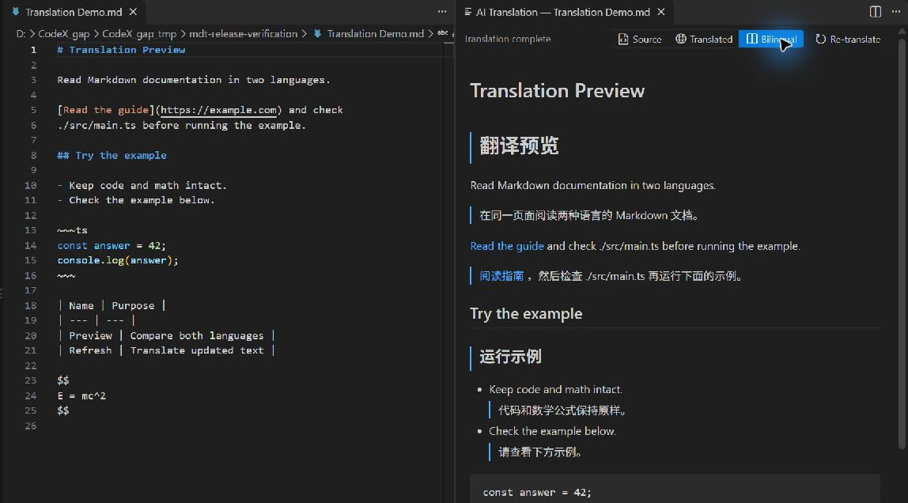

# Markdown AI Translator

[English](README.md) · [发布指南](docs/PUBLISHING.md) · [变更日志](CHANGELOG.md)

在 VS Code 中阅读 Markdown 技术文档时，可以在编辑器旁打开翻译预览，切换原文、译文和双语对照。翻译过程不会改写 Markdown 源文件。

[操作 GIF](docs/images/preview-demo.gif) 和截图采用本机模拟服务返回的固定示例译文。

## 快速开始

1. 使用 VS Code 桌面版 1.95 或以上版本，在「扩展 → … → 从 VSIX 安装」中打开本地 VSIX。
2. 在**用户设置**中填写扩展的 API Base URL 和模型。默认配置指向 OpenAI。
3. 运行 **Markdown AI Translator: 设置 API Key**，为当前端点保存凭据。如果环回地址上的本地服务关闭了鉴权，可填写 `local-only` 等临时值，扩展仍会把它放入 Bearer 请求头。旧开发版本的用户需要为当前端点重新输入一次。
4. 打开 Markdown 文件，点击标题栏的地球图标，或运行**翻译文档**命令。右侧预览会开始翻译。
5. 在工具栏切换**原文／译文／双语**。**重新翻译**会绕过缓存。**取消**会停止当前文档任务。

## 功能与边界

- 每个 Markdown 文档复用一个预览面板。编辑后，可见的面板在短暂延时后刷新。隐藏面板在再次显示时处理期间发生的编辑。有效缓存可复用配置相同的未改文本。
- 通过 markdown-it token 提取正文，译文按 ID 回填。双语模式支持标题、段落、列表、引用及表格单元格。全文翻译跳过代码块、行内代码、Mermaid 源码、可解析的公式、YAML front matter、原始 HTML 块、链接和图片目标，以及可识别的 URL 和路径。链接显示文本和常规图片替代文本可以翻译。必须保留的特殊路径或标识符请用反引号包裹。
- 文档按近似 token 数分批请求，并可设置每次文档任务的并发上限。请求超时覆盖响应正文。可重试错误会按退避策略重试。单个超长文本段仍可能超过设定的分块估算。
- 在预览中选择文字，点击浮动的**翻译**按钮，可查看、复制和关闭译文卡片。起点在代码内的选区不会显示按钮。编辑器中的**翻译选中文本**命令会在侧栏显示结果，起点在围栏代码块内时先询问确认。[划词结果截图](docs/images/selection-result.png)
- 活动栏的翻译侧栏显示当前端点是否已配置密钥、最近的文档状态事件与最近一次选区译文，并提供常用命令。

## 提供商兼容性

扩展调用非流式 OpenAI 风格的 Chat Completions，发送 Bearer 请求头、模型和温度。若 JSON 模式请求返回 HTTP 400，会去掉该字段再尝试一次。模型仍需按约定为全部片段返回 JSON。

| 提供商 | 配置示例 | 验证情况 |
| --- | --- | --- |
| OpenAI | `https://api.openai.com/v1` | 已核对接口文档，未进行真实联调。[官方文档](https://developers.openai.com/api/reference/resources/chat/subresources/completions/methods/create) |
| DeepSeek | `https://api.deepseek.com` | 已核对接口文档，未进行真实联调。[官方文档](https://api-docs.deepseek.com/api/create-chat-completion) |
| Moonshot / Kimi | 以 Kimi 账号显示的端点为准 | 兼容候选，未进行真实联调。[开发平台](https://platform.kimi.ai/) |
| Ollama | `http://127.0.0.1:11434/v1` | 已核对接口文档，未运行真实服务或模型。[官方文档](https://docs.ollama.com/api/openai-compatibility) |
| LM Studio | `http://127.0.0.1:1234/v1` | 已核对接口文档，未运行真实服务或模型。[官方文档](https://lmstudio.ai/docs/developer/openai-compat) |
| Azure OpenAI | 依部署而定 | 需要查询参数、专用鉴权头或自动刷新令牌的部署超出当前适配器范围，未进行真实联调。[官方文档](https://learn.microsoft.com/en-us/azure/foundry/openai/api-version-lifecycle) |

通用协议通过自动化测试和本机 HTTP 模拟服务验证。上表各服务均未被调用。

## 命令与设置

在命令面板检索 **Markdown AI Translator**，可找到全文翻译、重新翻译、选区翻译、设置和清除 API Key，以及打开扩展设置。配置项都以 `markdownAiTranslator.` 开头。

| 配置 | 默认值 | 用途 |
| --- | --- | --- |
| `apiBaseUrl` | `https://api.openai.com/v1` | 在用户设置中配置。远程用 HTTPS，环回地址可用 HTTP。 |
| `model` | `gpt-4o-mini` | 服务端模型 ID。 |
| `sourceLanguage` | `auto` | 让模型识别源语言，或使用指定语言。 |
| `targetLanguage` | `简体中文` | 目标语言。 |
| `systemPrompt` | 技术翻译提示词 | 支持 `{sourceLanguage}` 和 `{targetLanguage}`。 |
| `temperature` | `0.3` | 发给模型的采样温度。 |
| `translationMode` | `translated` | 预览的默认显示模式。 |
| `requestTimeout` | `60000` | 每次请求的超时毫秒数，含响应正文。 |
| `maxConcurrency` | `3` | 单次文档任务内的最大并发请求数。 |
| `maxTokensPerRequest` | `4000` | 分块估算预算。 |
| `maxRetries` | `2` | 可重试错误的重试次数。 |
| `cacheEnabled` | `true` | 读取及写入持久化翻译缓存。 |
| `cacheTtlDays` | `30` | 缓存结果可复用的天数。 |

## 隐私

- 当打开翻译预览、重新翻译、编辑已打开预览的文档或翻译选区时，扩展宿主可能向配置的端点发送文本片段、语言配置、系统提示词、模型 ID 和该端点的鉴权请求头。提供商如何处理与保留数据取决于其条款。
- API Key 存在 VS Code SecretStorage，按规范化的 API 端点区分。**清除 API Key** 会移除当前端点的凭据和旧版未绑定端点的条目。请避免把密钥写进 URL、设置、提示词或文件正文。
- 扩展会在 VS Code 本地状态中保存译文缓存。关掉缓存仅停止后续读写，旧数据在关闭缓存或过期后仍可能留在磁盘。扩展本身没有实现遥测。
- Webview 对脚本使用 nonce，并对展示 HTML 做清洗。文档中的远程图片可能直接发起 HTTP(S) 请求。打开链接也可能访问目标站点。

## 开发与许可证

使用 Node.js 24。执行 `npm ci`、`npm run compile`、`npm run lint`、`npm test` 和 `npm run package`。在 VS Code 启动 Extension Development Host 后可打开[示例文档](sample/demo.md)。[发布指南](docs/PUBLISHING.md)提供验证步骤。

[MIT](LICENSE)
