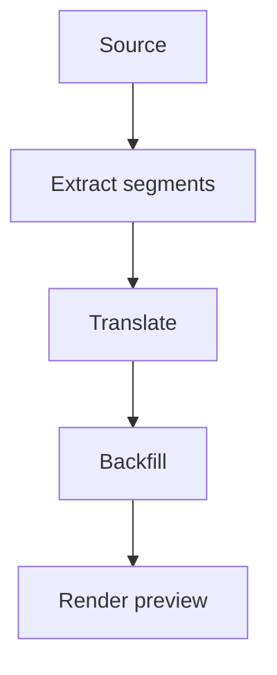
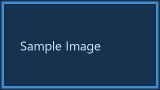

# Markdown AI Translator Demo

This is a demo document used to verify the extension in the VS Code
Extension Development Host. Click the **globe button** in the editor title
bar to open the translation preview.

## What gets translated

- Headings like this one.
- Plain paragraphs with `inline code`, **bold text**, *italic text* and
  [links](https://github.com/brakerham/vscode-md-translator).
- Lists (nested too):
  1. First item.
  2. Second item with a sub-list:
     - Sub item A.
     - Sub item B.
- Task lists:
  - [x] Implement translation
  - [ ] Publish to the Marketplace
- Blockquotes:

> Keep technical terms, API names, function names, variable names and
> project names as-is, for example `git push` or `OpenAICompatibleProvider`.

## What must never be translated

```python
# Code blocks are protected — including this comment.
def hello(name: str) -> str:
    return f"Hello, {name}!"
```



Inline math like $E = mc^2$ and block math:

$$
\sum_{i=1}^{n} i = \frac{n(n+1)}{2}
$$

Links keep their URLs: [API docs](https://example.com/api), and images keep
their sources:



## Tables

| Feature | Status | Notes |
|---|---|---|
| Full document translation | Done | Structure-aware |
| Bilingual mode | Done | Block pairing |
| Selection translation | Done | Floating card |
| Mermaid diagrams | Protected | Rendered, not translated |

## Raw HTML

<div align="center">
  <strong>Raw HTML blocks are sanitized and never translated.</strong>
</div>

The end.
